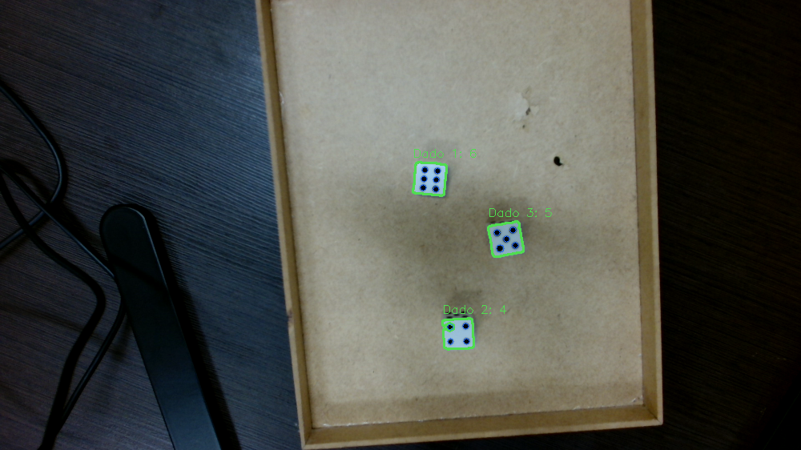

# Calibração da C920 — faces 4, 5 e 6

Cena real analisada: três dados claros sobre uma bandeja, com as faces 4, 5 e 6.
Captura da HD Pro Webcam C920 em 1920×1080, zoom 1×, brilho 0 e processamento
em 1000×562. A ordem espacial na captura é **6, 4, 5**, com **soma 15**.

## Diagnóstico

Foram comparados os filtros em 20 frames reais separados por aproximadamente
250 ms. O perfil anterior acertou somente os três dados em **12/20 frames**.
Nos demais, acrescentou um falso dado com valor 1 (**5 frames**) ou 2 (**3 frames**)
em uma região irregular à esquerda da bandeja. As três faces reais já eram
detectadas; o erro estava principalmente na aceitação de candidatos do fundo.

| Medida | Faces reais nos 20 frames |
| --- | --- |
| Área / imagem | 0,2398% a 0,2686% |
| Largura / altura | 0,936 a 1,051 |
| Extent | 0,725 a 0,873 |
| Solidez | 0,954 a 0,971 |
| Área do ponto / face | 2,16% a 3,71% |
| Circularidade do ponto | 0,791 a 0,948 |
| Proporção do ponto | 0,778 a 1,250 |

Os candidatos de fundo tinham extent de 0,350 a 0,554. Os falsos dados aceitos
ocupavam bounding boxes com extent de aproximadamente 0,38 a 0,44. A solidez
do fundo variava de 0,564 a 0,873; por isso os filtros são usados em conjunto.

## Valores aplicados

| Filtro | Anterior | Perfil C920 |
| --- | --- | --- |
| Área da face / imagem | 0,05%–3% | **0,10%–3%** |
| Proporção da face | 0,55–1,60 | **0,70–1,40** |
| Extent mínimo | 0,35 | **0,45** |
| Solidez mínima | Desativada | **0,85** |
| Área do ponto / face | 0,4%–10% | **0,8%–7,5%** |
| Circularidade mínima | 0,55 | **0,65** |
| Máscara da face | Contorno original | **Envoltória convexa** |

Mantidos: threshold **adaptativo gaussiano** nas duas etapas, bloco 101 e
C = −10 nas faces; bloco 31 e C = 7 nos pontos; proporção dos pontos entre
0,60 e 1,50; Gaussian Blur 5×5; fechamento elíptico 5×5 com duas iterações;
abertura das faces com uma iteração; abertura dos pontos elíptica 3×3 uma vez.

A solidez é `área do contorno / área da envoltória convexa`. Ela elimina regiões
com grandes reentrâncias e complementa o extent. Manter o extent em 0,45 permite
aceitar faces giradas, cuja área ocupa uma fração menor do retângulo alinhado
aos eixos. A solidez aparece em **Filtros → Faces** e na
**Análise das faces**. Referência: [propriedades dos contornos no OpenCV](https://docs.opencv.org/4.x/d1/d32/tutorial_py_contour_properties.html).

Uma segunda sequência de 40 frames mostrou um caso em que uma reentrância
na máscara excluía o quarto ponto da face 4. O contorno da face continua sendo
usado para as medidas geométricas; a máscara de isolamento passa a preencher
sua envoltória convexa. Essa correção recuperou o ponto: a sequência passou de
**39/40** contagens corretas para **40/40**, sem incluir candidatos do fundo.
A opção é ajustável em **Filtros → Faces → Preencher máscara convexa** e fica
ativa no Perfil C920. Restaurar os padrões do PDF volta à máscara do contorno.

## Resultado e reprodução

Na comparação sobre os mesmos 20 frames, o perfil calibrado identificou
**exatamente três candidatos aceitos, com valores 4, 5 e 6, em 20/20 frames**.
A validação final cobriu **60 frames salvos** (20 da primeira sequência e 40
da segunda), todos corretos, e **20 novos frames ao vivo**, também todos corretos.
A soma foi **15** em todos. Isso descreve esta amostra, sem garantir o resultado
para qualquer iluminação, distância, foco ou perspectiva.



**Filtros → Perfil C920 → Aplicar** reaplica essa calibração;
**Restaurar padrões do PDF** continua disponível. O aplicativo agora inicia
com o Perfil EMEET, ajustado para a câmera padrão EMEET SmartCam S600.
Os **55 testes** incluem quatro frames reais, a reprodução de um falso positivo
anterior, o ponto recuperado pela máscara convexa, a rejeição de um contorno
côncavo com ponto escuro e dados de **1 a 6** girados
até 45°. O detector continua contando os pontos encontrados, sem impor valores
4, 5 e 6 ou restringir a cena a três dados.

```powershell
.\.venv\Scripts\python.exe -m unittest discover -s tests -v
```
